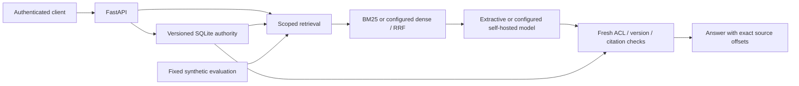

# Target architecture
Independent Python 3.12, FastAPI/Pydantic v2, stdlib SQLite for small local corpus metadata/text/vectors/audit. No upstream imports/config/history. Own .git/.venv/lockfile/runtime/cache/reports. Bind 127.0.0.1:8765.
Alternatives: upstream MySQL/Milvus/Celery increases operational coupling; hosted SaaS adds credentials/data/cost. Choose embedded measured baseline. This does not change property-ai's frozen stack. Native Windows Milvus Lite support is not assumed.

## Domain and lifecycle
Tenant owns workspaces. Server-configured principal has one tenant and explicit workspace grants, reader/editor and allowed audiences all/internal. Document has one workspace/fixed audience. Immutable numbered revisions; only successfully indexed latest revision may activate. Failed replacement leaves active revision usable. Archive excludes immediately; successful new revision can reactivate.
Persisted synchronous explicit ingestion endpoint, retryable after failure/process exit. No automatic background-worker claim. Provider calls outside write transactions; attempt token and latest-version compare-and-swap fence stale completion.

## Retrieval
SQL filters tenant/workspace/audience/current active version BEFORE scoring. Real BM25 with English words/CJK bigrams. Optional independently configured HTTP embedding, exact cosine at small scale; model/dimension fingerprint prevents mixed indices. Hybrid RRF. Optional reranker strictly validates indices/finite scores.
After remote calls, fresh SQL rechecks all returned chunks. Concurrent archive/version/access change causes refusal.
Default extractive answer quotes source; explicitly not an LLM. Optional self-hosted chat returns validated status/answer/citation IDs. Reject unknown IDs. Evidence is data, no tools/execution. Valid citation syntax alone cannot establish entailment; generation manual rubric remains separate.

## API
POST /documents; POST /documents/{id}/versions (expected_version); POST /documents/{id}/versions/{version}/ingest; POST /documents/{id}/archive; GET /documents and /documents/{id}; POST /query; GET /health; OpenAPI.
Bearer credential resolves local configured principal; no client tenant/role claims. Explicit synthetic bootstrap, never implicit anonymous demo auth. Stable errors/request IDs; body/token-free logs. Bound source/query/request size. Text/Markdown only, no URL fetching/arbitrary server paths.

## Verification
Test isolation/current revision/archive/concurrency/failed providers/reordered responses/false citations/no evidence/malformed input. Temporary DBs only here. Separate HTTP process demo and persistence restart. Evaluation raw rankings, Recall@k/MRR/nDCG, negative refusal, latency, corpus/config fingerprints. Separate OFFLINE_VERIFIED, HTTP_ADAPTER_CONTRACT_VERIFIED, LIVE_MODEL_VERIFIED only if run, PRODUCTION_NOT_ACCEPTED.
Production limits: single-node embedded storage, static local grants, no SSO/HA, no distributed ingestion. Revocation is checked at a response snapshot, not a linearizable lock through transport.

## Data flow

